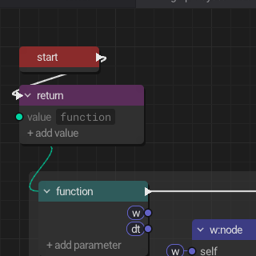
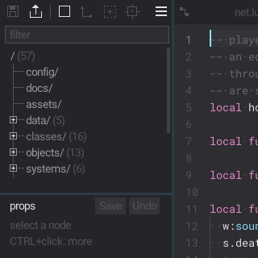
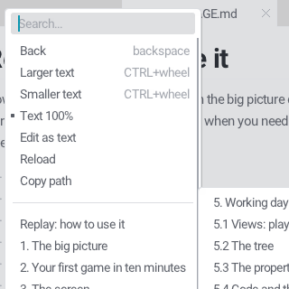
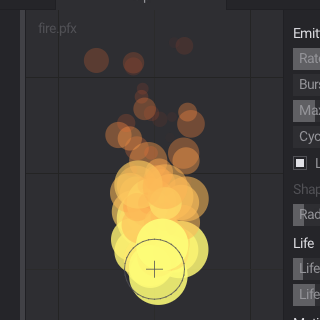

# gallery

Nine squares of the editor as it is now, for [README.md](../README.md)'s 3 x 3
grid, named `1.png` .. `9.png`: README.md shows them by number, so a new
capture by [gallery.py](gallery.py) just overwrites them. 320 x 320 crops of
offscreen screenshots, never scaled. The scenes (what's open, where) are in
[scenes.lua](scenes.lua).

    SDL_VIDEODRIVER=offscreen python3 docs/gallery/gallery.py ./play

| File | Shows |
|---|---|
|  | `1.png`: asteroids, playing |
|  | `2.png`: a system as a node graph (hop's HUD) |
|  | `3.png`: the toolbar, the world's tree and its code |
|  | `4.png`: a right-click menu (the light theme): HELP.md's sections |
|  | `5.png`: the tilemap editor |
|  | `6.png`: the sfxr sound editor |
|  | `7.png`: the particle editor (fire) |
|  | `8.png`: the atlas packer: Parcels' cut sheet |
|  | `9.png`: hop, a tile map level, zoomed in |
