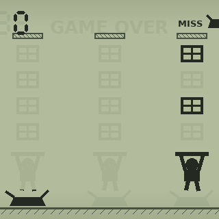

# lcd: Parcels

A small game in the spirit of the old LCD handhelds: `play games\lcd\`.
Parcels come down three chutes, one step each beat; you are the worker at
the bottom, moving between the three spots (left / right, or A / D) to
catch them on your tray. One that reaches the ground breaks: a miss. Three
misses and it's over; space or enter plays again. A gamepad: dpad or left
stick to move, A or START to play again. The beat quickens as the
score goes up.

How it's drawn, the way the real ones are:

- `assets/lcd_off.png`: the screen with nothing lit (the glass, the printed
  chutes and ground, every segment faintly). The root draws it (`image.lua`).
- `assets/lcd_on.png`: every segment, dark, on nothing.
- `assets/lcd.atlas.lua`: an atlas **cut** from `lcd_on.png` (plugins/atlaspacker):
  each segment a named frame (`man1`..`man3`, `box11`..`box34` for chute and
  row, `splat1`..`splat3`, `miss1`..`miss3`, `misslabel`, `over`, and the
  score's four seven-segment digits `d1a`..`d4g`). Open it to see them;
  *Find segments* finds them again on a new picture.
- `objects/lcd/<segment>/image.lua`: one node per segment, each drawing its
  frame where it is on the screen:
  `{ "/assets/lcd.atlas.lua", frame = "man1", at = "sheet" }`.
- `systems/game`: the game, on its state (`/data/game`: `state` and
  `rules`, the pace); `systems/lcd`: hides every segment that isn't lit.
  Stopped, nothing is hidden: the editor shows every segment, as a real
  one's power-on test.

Change the pictures (draw on `lcd_on.png`, run *Find segments*, rename the
new frames, add a node for each) and the game shows them. The art was made
for this demo; the game is offline, one player.
